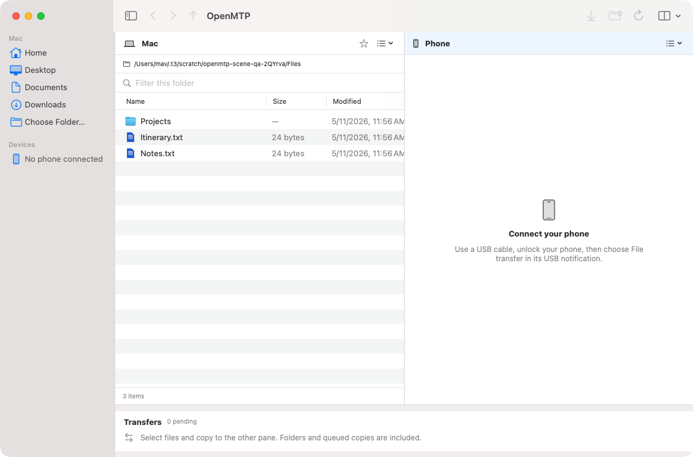

# OpenMTP

A native macOS app for transferring files between a Mac and an MTP device over USB. Built with SwiftUI, a pure Swift MTP engine and Apple's IOUSBHost framework.

This is the [aaditagrawal/openmtp](https://github.com/aaditagrawal/openmtp) fork of [Ganesh Rathinavel's OpenMTP](https://github.com/ganeshrvel/openmtp). The SwiftUI app replaces Electron and the Go/libusb bridge throughout the app, build and release workflows.

<picture>
  <source media="(prefers-color-scheme: dark)" srcset="macos/Design/screenshots/native-scene-dark.png">
  
</picture>

*Actual SwiftUI window with sample local files and a simulated phone. [Narrow icon view](macos/Design/screenshots/native-scene-narrow.png).*

## The native app

- Browse Mac and phone folders side by side, with independent navigation, selection, list/icon views and saved preferences. Toolbar search filters the active pane.
- Copy files and complete folder trees, including empty folders. The persistent transfer queue shows progress, speed and estimated time, with cancellation and retry after reconnecting. Retry starts the file again.
- Resolve conflicts with Skip, Replace, Keep Both or Smart Sync. Smart Sync compares file sizes and modification dates; removing destination extras requires a separate confirmation.
- Drag files through Finder file promises, preview selections with Quick Look, and reveal local files in Finder. Local deletions go to Trash; phone deletions require permanent-deletion confirmation.
- Use native menus, keyboard shortcuts and light, dark or system appearance. macOS 26 and later use Liquid Glass toolbar groups and controls, with accessibility fallbacks.

Compatible preferences from the previous app import once without rewriting its settings file. The native app uses Sparkle for updates in configured, signed releases; preview builds use manual installation.

## Get a preview

Native builds are currently available from [Native macOS CI](https://github.com/aaditagrawal/openmtp/actions/workflows/main.yml) or by building from source. Open a successful `master` run and download the artifact for your Mac:

| Mac | Artifact |
| --- | --- |
| Apple Silicon | `OpenMTP-native-arm64` |
| Intel | `OpenMTP-native-x86_64` |

Extract the downloaded artifact to find its app ZIP and DMG. Preview packages are ad-hoc signed and are not notarized.

The existing v3.x [release](https://github.com/aaditagrawal/openmtp/releases) contains the previous Electron app. The upstream website and Homebrew cask also distribute the upstream app.

Connect your phone with a data-capable USB cable, unlock it and choose **File transfer** in its USB notification. Select the device and storage in OpenMTP's sidebar. Close competing MTP clients if the USB interface is in use; OpenMTP reports the owner when macOS provides that information.

## Build and run

Use a Mac with Xcode 26 or later, or matching Command Line Tools, providing macOS SDK 26+ and Swift 6.2+. The app targets macOS 13+. Liquid Glass requires macOS 26+; older systems use fallback controls.

```sh
git clone https://github.com/aaditagrawal/openmtp.git
cd openmtp
make test
make run
```

| Command | Result |
| --- | --- |
| `make verify` | Check the native build environment and shell scripts. |
| `make test` | Run protocol, transfer, workspace, parity and release-policy checks. |
| `make build` | Create `macos/build/OpenMTP.app`, including the `mtpctl` diagnostic CLI. |
| `make run` | Build and launch the app. |
| `make package` | Create app ZIP/DMG packages, manifests and checksums under `dist/`. |
| `make format-check` | Check Swift formatting. Use `make format` to apply it. |

Packages default to the host CPU. For a universal development build:

```sh
OPENMTP_ARCH=universal make package
OPENMTP_ARCH=universal ./macos/scripts/verify-package.sh
```

Use separate development preferences and an existing starting folder:

```sh
openmtp_dev_dir="$(mktemp -d)"
mkdir -p "$openmtp_dev_dir/profile" "$openmtp_dev_dir/files"
OPENMTP_PROFILE_DIR="$openmtp_dev_dir/profile" \
  OPENMTP_LOCAL_ROOT="$openmtp_dev_dir/files" make run
```

List USB device candidates without opening the graphical app:

```sh
macos/build/OpenMTP.app/Contents/MacOS/mtpctl devices
```

The build uses Swift Package Manager and its checked-in dependency lock. No Node, Bun, Electron, Go or libusb installation is required.

## Keyboard shortcuts

Select files, copy with Cmd+C, focus the destination pane and paste with Cmd+V. The toolbar's Copy to Phone / Copy to Mac action copies directly to the other pane. Text fields and selected error text retain native text-copy behavior.

| Action | Shortcut |
| --- | --- |
| Copy / paste | Cmd+C / Cmd+V |
| Append to copy selection | Cmd+Shift+C |
| New folder | Cmd+Shift+N |
| Open / rename | Cmd+O / Return |
| Quick Look | Space or Cmd+Y |
| Move to Trash / confirm phone deletion | Cmd+Delete |
| Icon / list view | Cmd+1 / Cmd+2 |
| Show hidden files | Cmd+Shift+. |
| Back / forward | Cmd+[ / Cmd+] |
| Parent folder / refresh | Cmd+Up / Cmd+R |
| Focus Mac / phone pane | Cmd+Option+Left / Cmd+Option+Right |

## Validation and development

Native CI runs on both Apple Silicon and Intel with macOS 26. The native replacement has passed 139 Swift tests; local checks also cover universal packaging and actual SwiftUI window rendering. Physical-phone compatibility, older macOS runtime behavior, interactive accessibility and signed update installation remain release checks. See [validation evidence and limitations](macos/VALIDATION.md).

MTP transactions run in order on a dedicated queue per connection. Capability-gated metadata batching reduces directory requests in simulated tests; real-device throughput improvements still require hardware measurements. Network transports and byte-offset pause/resume are not implemented.

- [Native architecture, protocol and performance notes](macos/README.md)
- [Feature comparison with the previous app](macos/PARITY.md)
- [Signing, notarization and native updates](macos/RELEASING.md)
- [Contributing](CONTRIBUTING.md)

The Electron source and toolchain remain in Git history at [`6eb3e7b`](https://github.com/aaditagrawal/openmtp/tree/6eb3e7b). Current development and CI build the SwiftUI app.

## Credits and license

OpenMTP was created by [Ganesh Rathinavel](https://github.com/ganeshrvel) and is distributed under the [MIT license](LICENSE). The app logo is by [Shubhendu Mitra](https://www.behance.net/soponhara). [NOTICE](macos/NOTICE) records native source provenance and historical protocol references. Sparkle's license is included with the app.
